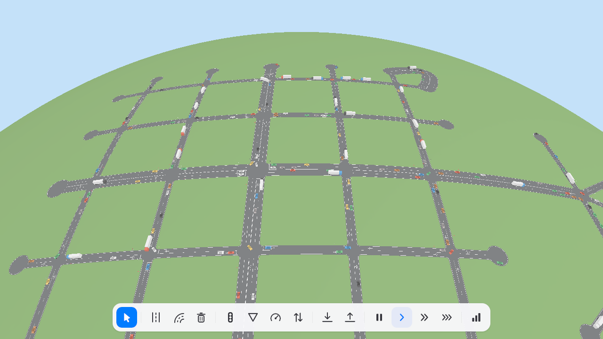
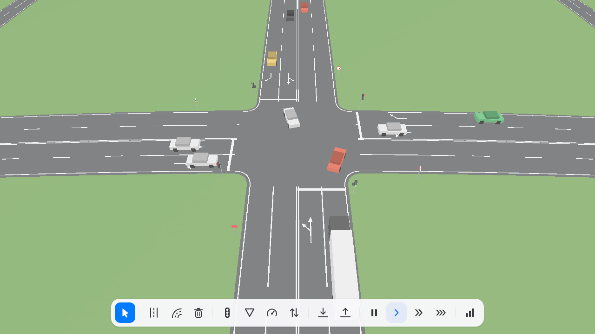
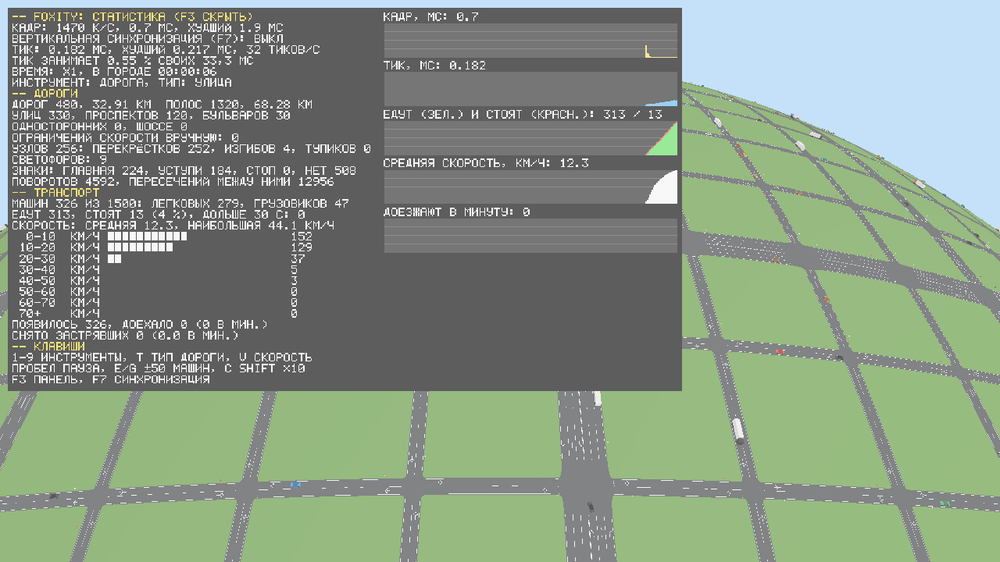
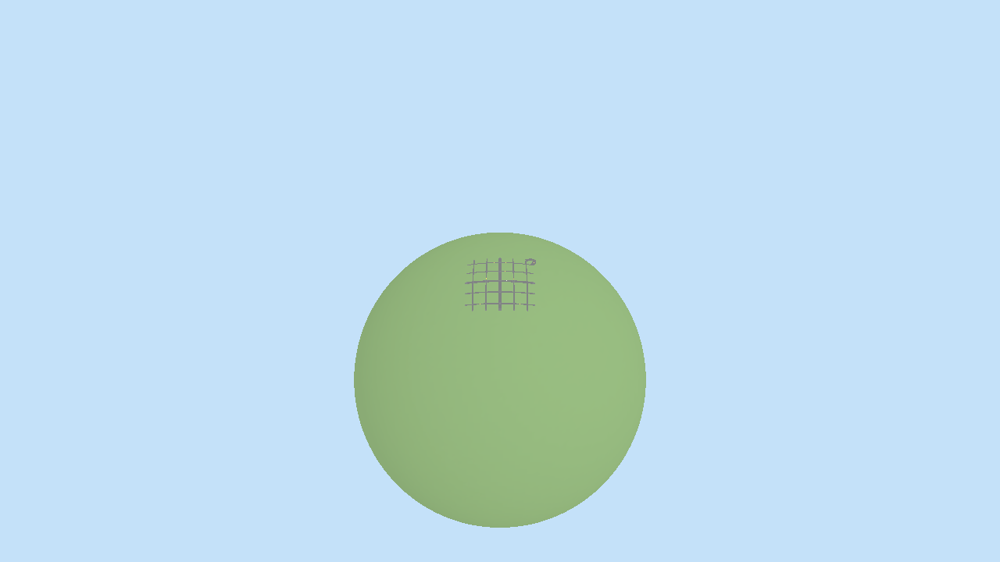

# Foxity

A city builder on a small planet, built on the
[laiue](https://github.com/landiunload/laiue) engine and inspired by SimCity and
Cities: Skylines.



Early development. Space is unbounded; in it hangs one planet, a ball a
kilometre in radius under an always bright sky. The planet is solid through
and through: it can be dug down to its core and piled up anywhere. Roads are
drawn as straight lines or curves draped over the ground; where they meet or
cross, intersections form by themselves, paved up to curved curbs, and the
roads are marked and signed on their own: lane lines that turn solid before
junctions, arrows for where each lane leads, priority and give-way signs
where a bigger road meets a smaller one, speed limits. Traffic lights, other
signs and limits can be put up by hand. Cars and slower, longer trucks drive
their lanes at real speeds, slow down for bends as their grip allows, keep
their distance, wait their turn at intersections, take the fastest route and
avoid jams. Each city chooses whether it keeps right or left when it is
founded, and districts can be laid over it that drive on the other side.

The simulation uses only integer arithmetic at a fixed tick rate, so the same
commands give the same city on every machine.







The engine's window, input, graphics, camera math, meshing and navigation are
loaded at run time. Any of them can be missing; the game then runs without that
technology instead of failing to start.

## Controls

| Input | Action |
|---|---|
| Mouse wheel | Zoom from 4 m to 9 km |
| Right mouse button | Rotate: the view turns the way the mouse moves |
| W A S D, Shift | Move, faster |
| Left mouse button | Use the tool |
| 1 | Road: click a start and an end; the next road continues from the end |
| 2 | Curved road: a start, a point to bend towards and an end |
| 3 | Bulldoze a road |
| 4, 5 | Dig the ground away or pile it up, held |
| 6 | Turn the district around the point to the other drive side |
| 7 | Traffic lights on or off at an intersection |
| 8 | Next sign at the nearer end of a road: priority, give way, stop, none, automatic |
| 9 | Raise a road's speed limit; with Shift lower it; past either end back to the road's own |
| T | Next road type: street 50 km/h, avenue 60, boulevard 70, one-way 50, highway 110 |
| V | Time at one, three or ten times real time |
| Space | Pause |
| E, G | Fifty cars more or fewer; with Shift five hundred |
| F3 | Statistics panel in Russian: frame and tick times, roads, junctions, signs, vehicles, speeds, arrivals, with graphs of the last minute |
| F7 | Vertical sync on or off |
| Esc | Drop the road being placed, or quit |

## Running

```bash
Foxity --drive left
```

| Option | Meaning |
|---|---|
| `--drive right\|left` | The city's drive side |
| `--cars N` | How many cars the city aims for |
| `--empty` | Start on bare ground instead of the demo town |
| `--grid N`, `--spacing M` | Start on a grid of N roads each way M metres apart |
| `--seed N` | The city's seed |
| `--camera-distance M` | The camera's distance to its focus |
| `--focus-east M`, `--focus-north M` | Where the camera looks first, from the pole |
| `--graphics d3d12\|vulkan` | Choose the graphics provider |
| `--no-vsync` | Start with vertical sync off |
| `--capture FILE.bmp`, `--capture-frame N` | Save frame N as a picture and quit |
| `--smoke` | Present three frames and exit |

`FoxityHeadless` runs the city without presentation:
`--ticks N --time-scale X --cars N --drive right|left --no-routing`. `--grid N --spacing M`
loads it with a grid of N roads each way instead of the demo town, and `--stats`
prints everything at the end: roads, nodes, signs, lanes, turns and conflicts;
vehicles, speeds by 10 km/h, arrivals and removals; ticks per second and tick
times.

## Building

The engine is cloned next to the game and built with it:

```bash
git clone https://github.com/landiunload/laiue.git ../laiue
cmake --preset windows-msvc
cmake --build --preset windows-msvc-release --parallel
ctest --preset windows-msvc-release --output-on-failure
```

Without `../laiue`, configure downloads the engine (`FOX_ENGINE_REVISION`,
`origin/main` by default, `locked` for the revision in `engine.lock`). A
prepared engine SDK is chosen with `-Dlaiue_DIR=...`.

Linux and macOS build the headless game and its tests. The design, rules and
checks are in [docs/architecture.md](docs/architecture.md) and
[CONTRIBUTING.md](CONTRIBUTING.md).

## License

MIT, see [LICENSE](LICENSE).
